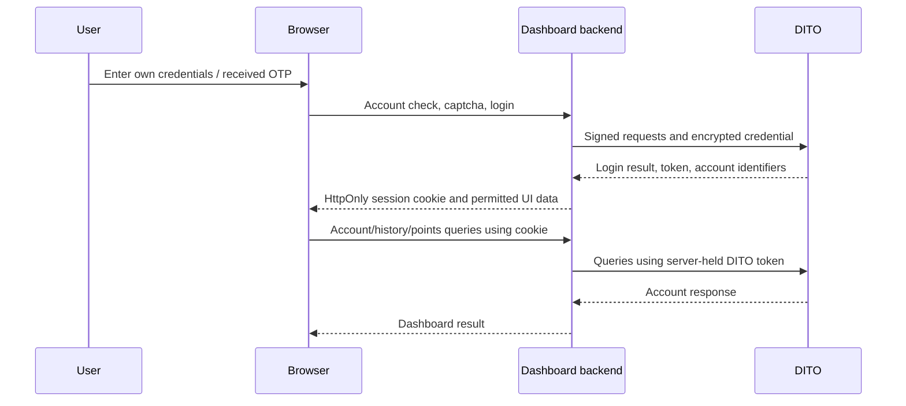
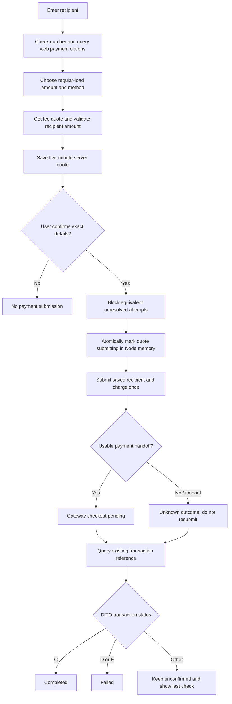

# How the reference implementation fits together

## Files to study first

| Component | File | Responsibility |
| --- | --- | --- |
| Local API and upstream adapter | [proxy-server.js](../reference/dito-login-test/proxy-server.js) | Static assets, sessions, signed DITO calls, account/history/catalog routes, load checkout endpoints |
| Load service | [load-purchase.mjs](../reference/dito-login-test/src/load-purchase.mjs) | Recipient validation, payment filtering, quotes, duplicate protection, handoffs, status |
| Browser UI | [app.js](../reference/dito-login-test/public/app.js) | Login, display, promo filters, confirmation, checkout links, redacted diagnostics |
| Page/layout | [index.html](../reference/dito-login-test/public/index.html), [app.css](../reference/dito-login-test/public/app.css) | UI controls and presentation |
| Catalog traversal | [promo-catalog.mjs](../reference/dito-login-test/public/promo-catalog.mjs) | Pagination, deduplication, incomplete-result warnings |
| Offline shell | [sw.js](../reference/dito-login-test/public/sw.js) | Versioned static cache; excludes `/api/` responses |
| Alternative backend | [worker.mjs](../reference/dito-login-test/src/worker.mjs) | Worker routes, encrypted sessions, same-origin policy, explicit unsupported-load guard |

## Login and account reads

The backend combines subscriber detail, account balance, resource allocation, and summary queries for account cards. History wrappers translate dates to DITO's expected date-time strings and pass page parameters. Login/captcha/OTP state and optional remembered passwords stay on the server; account/profile fields returned to the UI still require a deliberate allowlist in the new system.

## Promo browsing and its boundary

The local category wrapper fixes the parent to `ECARE_PROMO_WEB_PREPAID`. The browser iterates the returned **top-level** categories, fetches their pages, combines repeated offer IDs, and filters the fetched results by category/search. The helper detects repeated pages, preserves partial results, reports errors, and stops after 100 pages per category.

The word “all” in the current UI does not mean all DITO offers across channels. The current copy does not integrate nested `subProdCatgList`, personalized `isMCCM` categories, generic catalog comparison, recommendation trees, or a full recipient-specific data-promo catalog. Official inspected code also consumes `data.pageInfo.total`, which the current helper does not directly recognize; it can fall back to empty/repeated-page termination. Carry these limits into the new system's UI and research backlog.

The implemented promo purchase is the older **own-account** flow using `payment/prePay` and the signed-in account's number. The regular-load recipient feature below does not implement promo gifting.

## Regular load for a recipient

The submit request contains a quote ID and literal `confirmed: true`. The server takes amount, recipient, total, channel, and method from its saved quote; client edits cannot override them. Unresolved attempts for the same payer/recipient/amount block another quote or submit even if the method changes. The Map is updated synchronously before awaiting the upstream submission.

Only the exact web payment channel/method pairs found in the inspected frontend are offered. The implementation does not assume every method returned by DITO belongs to the web flow. The fee response's `originalAmount` supplies charge/validation units; its display total is shown for confirmation. No hardcoded currency multiplier or silent price fallback is used.

Gateway redirects must be HTTPS without URL credentials. Gateway forms run in a separate opaque sandbox with upstream scripts blocked; the app's nonce script submits the form. QR images are generated locally. These are code paths tested against fixtures, not a guarantee that every current gateway's live form works under the sandbox.

Checkout creation is not payment success. A timeout is never retried automatically, and a status check never submits another payment. Pending references are process-local: atomic protection does not survive a restart or span multiple server instances.

## Portability notes

The source exports its Node server without listening when imported, allowing isolated handler tests. A process-local session-store adoption hook was added for preserving the Map during a handler update; it is not an HTTP admin endpoint or durable storage. The source intentionally disables Worker load checkout rather than using KV as an unsafe substitute for atomic financial state.

The PWA shell currently uses cache revision 14. Static-code updates require a cache version change or hard refresh. API/account/payment responses are not cached by the service worker. The frontend's localhost two-port compatibility path is legacy; a single origin is the preferred local setup.
